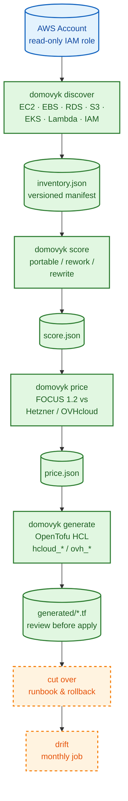

  

# domovyk

**Open-source planner for moving AWS workloads to EU providers (OVHcloud, Hetzner).** A Go CLI that runs on your own machine with a read-only IAM role — discover, score, price, and generate an OpenTofu target without moving data or trusting a third-party service.

## What it does

| Command | Purpose | Status |
|---|---|---|
| `discover` | Read-only inventory of an AWS account into `inventory.json`. EC2/EBS, RDS, S3, EKS, Lambda, IAM — paginated, nil-safe, with per-service coverage manifest. | ✅ Implemented |
| `score` | Classify each resource as `portable`, `rework`, or `rewrite` against the open mapping data (`map/domovyk-map.yaml`). | ✅ Implemented |
| `price` | Compare a FOCUS 1.2 billing export with sourced Hetzner/OVHcloud price lists. Every row carries a `checked_on` date and `verified`/`unverified` status. | ✅ Implemented |
| `generate` | Emit OpenTofu HCL (`hcloud_*` / `ovh_*`) for portable/rework resources from a scored inventory. Rewrite and unknown resources are skipped; review and right-size before `tofu apply`. | ✅ Implemented |

## Architecture



**Implemented:** discover, score, price, generate (build, `go vet`, `go test` all pass; CI on every push/PR).  
**Roadmap:** cut over (runbook, rollback), operate (monthly drift job) — not yet built.

## Quick start

```sh
# 1. Build
go build ./cmd/domovyk

# 2. Discover (read-only; needs AWS credentials)
./domovyk discover --region eu-central-1 --out inventory.json

# 3. Score
./domovyk score --inventory inventory.json --out score.json

# 4. Generate OpenTofu HCL for Hetzner (default) or OVHcloud
./domovyk generate --inventory inventory.json --out generated --target hetzner
./domovyk generate --inventory inventory.json --out generated --target ovhcloud

# 5. Try price with the bundled synthetic FOCUS export
./domovyk price --focus internal/price/testdata/focus.csv --out price.json
```

`discover` uses `--profile` for a named profile; on this machine the default profile resolves an assumed-role ARN through `~/.aws/config` (set by `aws login`), so live discovery needs valid refreshable credentials — EC2 IMDS is unreachable off-instance.

`discover` needs AWS credentials (`~/.aws/credentials` or `AWS_ACCESS_KEY_ID`/`AWS_SECRET_ACCESS_KEY`). It uses the AWS SDK default credential chain — secret keys are never accepted on the command line (issue #4 reliability gate).
## Capabilities

| Capability | Detail |
|---|---|
| Read-only discovery | Paginated AWS API calls, caller context + 2-minute per-service timeout, nil-safe response conversion, per-service coverage manifest |
| Versioned inventory | `inventory.json` with `manifest.schema`, `account_id`, `region`, `regions`, `services[].{attempted,completed,pagination_complete,first_error}`, `total_resources` |
| Portability scoring | Schema-validated mapping rows (`map/domovyk-map.yaml`, 30 rows each carrying `checked_on` and `status` per `map/SCHEMA.md`), exact-match-then-substring matching, stable result ordering |
| Price comparison | FOCUS 1.2 CSV parsing, explicit FX conversion, `no_price` with provenance (never invents a verification date), atomic mode-0600 output |
| OpenTofu generation | `hcloud_instance`, `hcloud_volume`, `ovh_instance`, `ovh_volume`, `hcloud_database`, `ovh_database`, `hcloud_bucket`, `ovh_bucket` HCL with advisory pricing; provider block + `required_providers` emitted so `tofu apply` can run after review |

## Honest limits

- It plans, it does not move. `generate` emits OpenTofu HCL; you review, right-size, and `tofu apply` yourself. Nothing is provisioned automatically.
- `generate` instance types are best-effort approximations, not verified capacity matches.
- It will say no to Lambda-heavy accounts. Those are `rewrite`, not a lift-and-shift.
- No compliance claims. This is not legal advice. The EU Data Act text is the reference.
- Prices are point-in-time. Read the `checked_on` date before trusting a number.
- The IAM policy in `iam/` has been reviewed against the actual SDK calls but not yet run through the AWS IAM policy simulator.

## Roadmap

v0.0–v0.3 are implemented (`discover`, `score`, `price`, `generate`). v0.4–v0.5 (measured cut-over, monthly drift job, plugin contract tests) are roadmap-only. See `docs/ROADMAP.md`.

## Docs

| Document | What it covers |
|---|---|
| `docs/SPEC.md` | Architecture, versioned inventory schema, six stages, credentials, price-list source decision |
| `docs/ROADMAP.md` | Release plan, gates from GitHub issues #1 / #3 / #4 |
| `docs/RESEARCH.md` | Competitors and open questions, verified vs unverified labels |
| `docs/THREAT-MODEL.md` | Draft threat model (not yet reviewed) |
| `docs/AWS-E2E-FINDINGS.md` | Real AWS eu-north-1 discovery results |
| `tf/reference-aws/` | OpenTofu reference setup (VPC, EC2, RDS, S3, ALB) — sandbox account only |

## Build & CI

```sh
go build ./cmd/domovyk
go vet ./...
go test ./...
```

CI: GitHub Actions runs build/vet/test on every push and PR (`.github/workflows/ci.yml`).

Container proof: `deploy/k8s/README.md` — builds `domovyk:dev`, runs `domovyk score` on a local kind cluster, real output captured.

## Licence

Code: Apache-2.0 (full text in `LICENSE`). Mapping data in `map/`: intended CC-BY-4.0 (licence file for the data not added yet).
